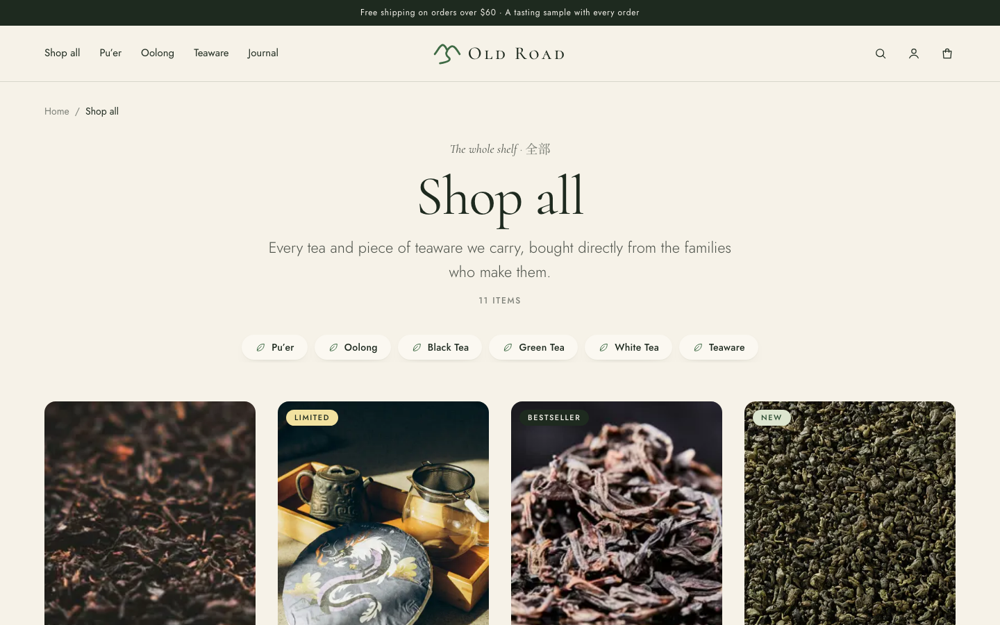
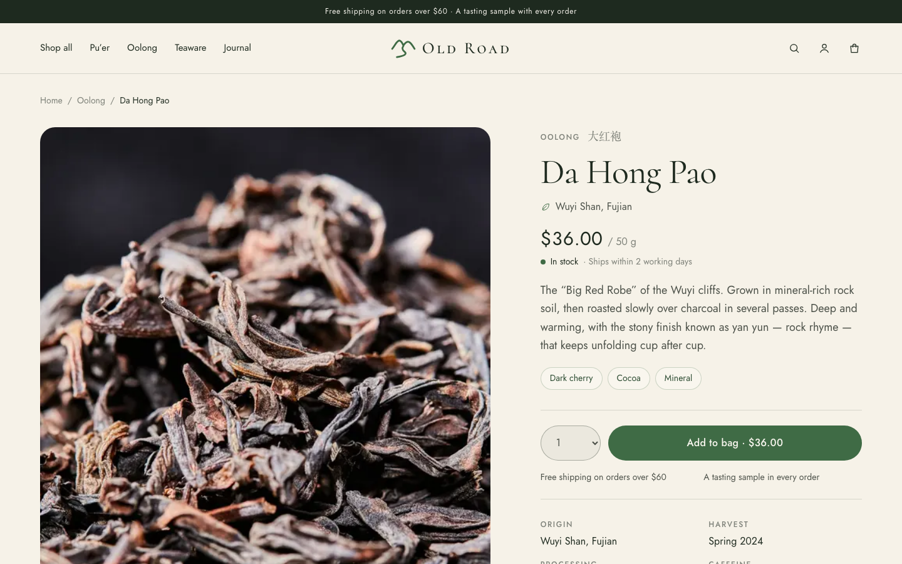
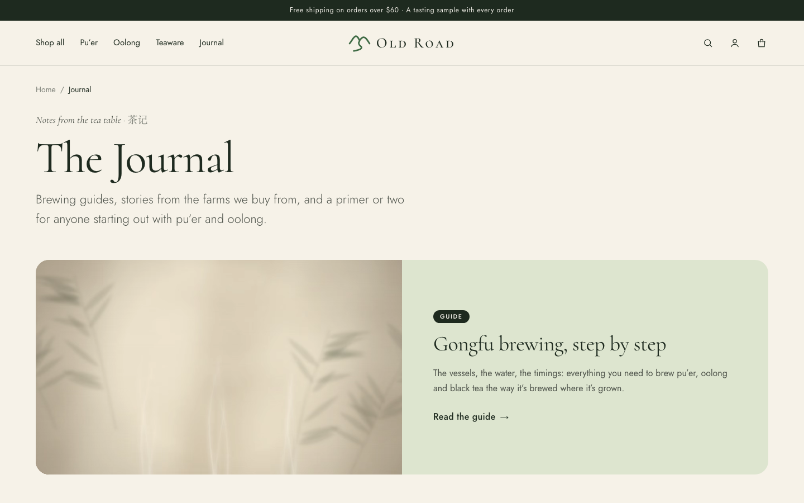
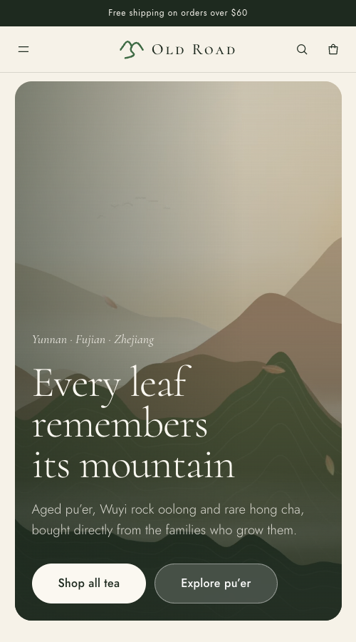

# Old Road — a full-stack tea shop

**Old Road** is an online store for traditional Chinese tea (pu’er, rock oolong, black tea) and teaware. It's a complete e-commerce app: a product catalog, a shopping bag, Stripe payments, customer accounts with order history, an admin dashboard and an editorial journal.

It's a portfolio project, built to production standards. Checkout takes real Stripe payments (in sandbox mode), stock is tracked accurately when several people buy at once, and every protected action is authorized on the server.

**Live demo: [tea-shop-coral.vercel.app](https://tea-shop-coral.vercel.app)**


## Screenshots

| Shop | Product page |
| --- | --- |
|  |  |
| **Journal** | **Mobile** |
|  |  |

## Tech stack

| Area | Tools |
| --- | --- |
| Framework | Next.js 16 (App Router, Server Components, Server Actions), React 19, TypeScript |
| Styling | Tailwind CSS v4 with a custom design system (tokens and utilities in `globals.css`) |
| Database | Neon serverless Postgres, Drizzle ORM, versioned SQL migrations |
| Auth | Better Auth: email/password and Google OAuth, role-based access (customer/admin) |
| Payments | Stripe Checkout and webhooks |
| Email | EmailJS for the contact form and shop notifications |
| Tooling | pnpm, ESLint, Vercel-ready |

## Features

**For shoppers**
- Catalog with collections, product pages (tasting notes, brewing guide, gallery), search and new arrivals
- A shopping bag that works without an account, with live stock and price checks
- Hosted Stripe checkout, success and cancel flows, and order history in the account area
- Journal articles and a brewing guide, plus shipping, help, sourcing and contact pages
- Newsletter signup, responsive layout and seasonal motion video on the homepage

**For the shop owner**
- Admin dashboard to manage products, collections and stock
- Read-only views of orders and contacts (registered customers and newsletter subscribers)
- Email notifications for new sign-ups and subscribers

## Engineering highlights

- **Correct inventory under concurrency.** At checkout, the order is created and its stock reserved in a single database batch. A `CHECK (quantity >= 0)` constraint makes the reservation all-or-nothing, so two buyers can never both get the last item. Expired or cancelled payments return the stock.
- **Idempotent payment handling.** Only Stripe can mark an order as paid: the server reads the Checkout Session back from the Stripe API and never trusts the client. Each status change is one conditional `UPDATE … WHERE status = 'pending'`, so duplicate or out-of-order webhooks do no harm.
- **The server is the source of truth.** The cart cookie holds only product slugs and quantities. Prices and stock are re-read from the database on every render and every action, so a tampered cookie can't change what a customer pays.
- **Security by default.** Authorization checks run at the top of every protected page *and* every server action (layouts alone aren't trusted). Admin routes return 404 to non-admins, users can't set their own role, and redirect targets are restricted to same-site paths.
- **Safe admin edits.** Stock updates only apply if the quantity hasn't changed since the page loaded, so an admin edit can't overwrite a reservation made during checkout.
- **Money as integers.** All prices are stored and calculated in cents.
- **Builds without secrets.** The database client is created lazily, so `next build` never needs a database connection, and catalog pages render dynamically to show current stock.

## Project structure

```
src/
  app/          Routes: storefront, cart, checkout, account, admin, journal, API (auth + Stripe webhook)
  components/   Shared UI (header, user menu, product cards, …)
  db/           Drizzle schema, client, seed data
  lib/          Catalog/cart/admin queries, orders, auth, session guards, site copy
drizzle/        Versioned SQL migrations
```

## Running locally

Requirements: Node.js, pnpm, a Neon (or any Postgres) database, and a Stripe sandbox account.

```bash
pnpm install
cp .env.example .env.local    # fill in DATABASE_URL, BETTER_AUTH_SECRET, Stripe and EmailJS keys
pnpm db:migrate               # apply migrations
pnpm db:seed                  # load the sample catalog
pnpm dev                      # http://localhost:3000
```

For local payment webhooks:

```bash
stripe listen --forward-to localhost:3000/api/stripe/webhook
```

To make a user an admin, run this SQL: `update "user" set role = 'admin' where email = 'you@example.com';`

Self-checks for the cart and admin form rules:

```bash
pnpm tsx src/lib/cart.check.ts
pnpm tsx src/lib/admin-forms.check.ts
```

## Author

Built by **Nikita Yeldynov**: [github.com/yeldynov](https://github.com/yeldynov)
